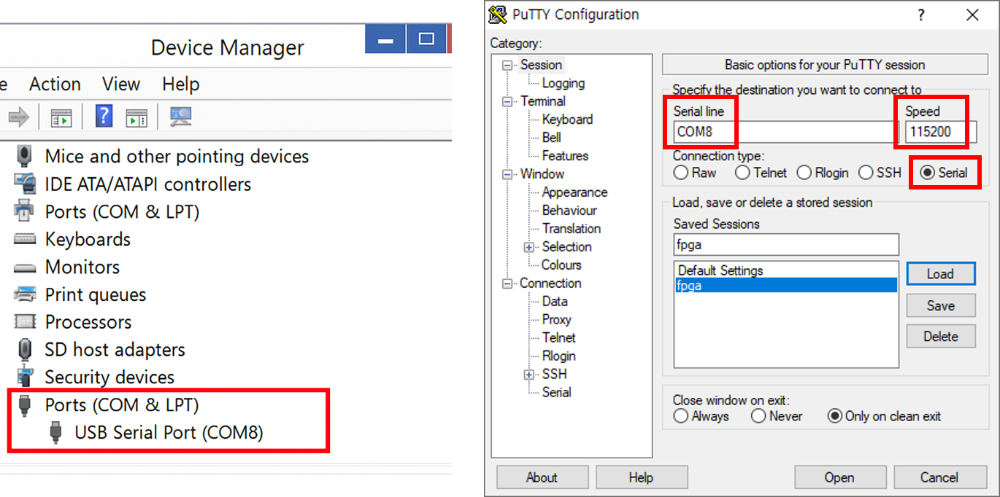
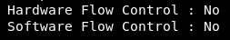

# ARX CLI Manual for Linux/Windows: FPGA Prototyping

## Overview

- This manual is intended for validating applications on an FPGA platform.

- This process requires an FPGA board compatible with ARX ([Supported Boards](https://npx-soc.readthedocs.io/en/latest/rvx-fpga-manual-en.html)).

- This process also requires a license for AMD Vivado, which must be obtained separately.

## Prototyping Functionality

### Creating a Prototyping Directory

- Prerequisite: `Synthesizing a Platform`

- Command:

    ```text
    cd #(platform dir)
    make #(FPGA name) // i.e., make arty-100t
    ```

- Result:  
    `#(platform dir)/imp_#(fpga name)_#(date)` is created,  
    which we refer to as `#(fpga dir)`.

- Note: `#(fpga dir)` is automatically managed by the ARX tool.

### Creating a Vivado Project

- Command:

    ```text
    cd #(fpga dir)
    make project
    ```

### Generating an FPGA Bitstream

- Included Process: `Creating a Vivado Project`

- Command:

    ```text
    cd #(fpga dir)
    make imp
    ```

- Result:  
    A bitstream and reports are generated in the `#(fpga dir)/imp_result` directory.

### Cleaning All Vivado Results

```text
cd #(fpga dir)
make clean
```

## Validating Functionality

For the following functionalities, you must power on the FPGA board and connect it to your computer.

### Programming the FPGA with the Generated Bitstream

- Prerequisite:

    - `Generating an FPGA Bitstream`

    - An FPGA board connected to your computer - [Manual](https://npx-soc.readthedocs.io/en/latest/rvx-fpga-manual-en.html)

- Command:

    ```text
    cd #(fpga dir)
    make program
    ```

### Opening the Terminal to View `printf` Output

- Prerequisite: `Programming the FPGA with the Generated Bitstream`

#### Command

=== "Linux"

    ```text
    cd #(fpga dir)
    make printf
    ```

=== "Windows"

    

    *Device Manager and PuTTY.*

    ```text
    cd #(fpga dir)
    make printf
    ```

    > Device Manager and PuTTY will be launched.

    Check the USB Serial Port number in Device Manager.

    > In the figure below, the port number is COM8.

    On PuTTY, configure the settings as highlighted by the three red boxes in the figure below.

    > If you save the session, you can reuse these settings later.

    Open

### Running an Application on the FPGA Prototype

#### Common

- Prerequisite:

    - `Developing an Application`

    - `Programming the FPGA with the Generated Bitstream`

    - `Opening the Terminal to View printf Output`

- Note:

    - `Build` compiles only the parts that have changed.

    - Make sure all the sliding switches of the FPGA board are set to the down position.

#### Running an Application

- Included Process:

    - `Building an Application` with `BUILD_MODE=debug`

```text
cd #(fpga dir)
make #(app name).run
```

#### Running an Application with a Rebuild

- Included Process:

    - `Cleaning Build Results`

    - `Building an Application` with `BUILD_MODE=debug`

```text
cd #(fpga dir)
make #(app name).rerun
```

#### Running an Application with Optimization

- Included Process:

    - `Building an Application` with `BUILD_MODE=release`

```text
cd #(fpga dir)
make #(app name).opt
```

#### Running an Optimized Application with a Rebuild

- Included Process:

    - `Cleaning Build Results`

    - `Building an Application` with `BUILD_MODE=release`

```text
cd #(fpga dir)
make #(app name).reopt
```

#### Running an Application with Profiling

- Included Process:

    - `Cleaning Build Results`

    - `Building an Application` with `BUILD_MODE=profile`

```text
cd #(fpga dir)
make #(app name).profile
```

## Auxiliary Functionality

### When `#(fpga dir)` changes from bitstream generation.

```text
cd #(fpga dir)
make path
```

### Open a Vivado Project

- Prerequisite: `Creating a Vivado Project`

- Command:

    ```text
    cd #(fpga dir)
    make open_project
    ```

### Displaying Available FPGA List

```text
cd #(platform dir)
make fpga_list
```

### Displaying Applications List

```text
cd #(fpga dir)
make app_list
```

### Deleting All Prototyping Directories

```text
cd #(platform dir)
make clean_imp
```

### Enabling Keyboard Input in Minicom



*Minicom Setup.*

```text
sudo minicom -s
```

Select "Serial port setup".

Configure the settings as shown in the figure below.
