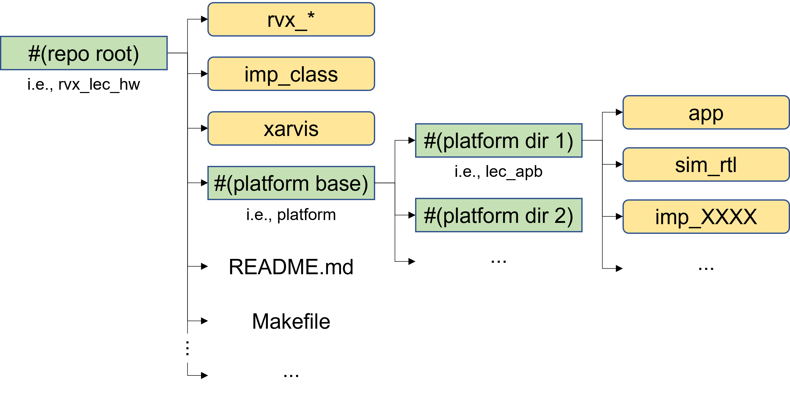

# ARX CLI Manual for Linux/Windows: Platform

## Overview

A platform includes both the hardware and software associated with an SoC. It is organized under a directory that shares the same name as the SoC the user intends to design.



*Detailed Structure of the Platform Directory.*

In the figure below, `lec_apb` is both the name of the SoC and the name of the corresponding directory.

## File Structure

The structure under `#(platform dir)` is as follows:

| Path | Usage | Description |
| :---: | :---: | :---: |
| ./#(platform name).xml | Editable | SoC description file |
| ./app/ | Editable | Application development environment |
| ./user/ | Editable | User-managed environment |
| ./util/ | Editable | Utility environment |
| ./sim_rtl/ | Use Only | RTL simulation environment |
| ./imp_XXXX/ | Use Only | FPGA prototyping environment |
| ./arch/ | System Reserved | Generated from ./#(platform name).xml |
| ./fpga_component/ | System Reserved | Used in imp_XXXX |

## Functionality

### Creating a New Platform

- Command:

    ```text
    cd #(platform base)
    make new PLATFORM_NAME=#(platform name)
    ```

- Result:  
    `#(platform base)/#(platform name)` is created,  
    which we refer to as `#(platform dir)`.

### Designing a Platform

- Prerequisite: `Creating a New Platform`

- Command:

    ```text
    cd #(platform dir)
    ```

    Edit the ./#(platform name).xml file with a text editor.

### Synthesizing a Platform

- Prerequisite: `Designing a Platform`

- Command:

    ```text
    cd #(platform dir)
    make syn
    ```

- Result: `#(platform dir)/arch` is created.

- Note: `#(platform dir)/arch` is automatically managed by the ARX tool.

### Cleaning All Platform Results

The following files and/or directories are maintained:  
`./#(platform name).xml`, `./app`, `./user`, and `./util`

```text
cd #(platform dir)
make clean
```
