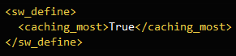
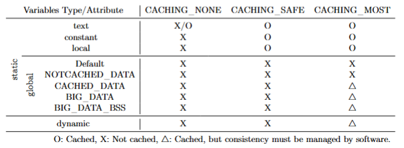

# ARX Software Development Manual: Data Consistency Management

## Overview

- ARX does not provide abstraction for hardware caches, so software-level consistency management is required in certain cases.

- With a default caching policy, data consistency management is not required.

- To enhance performance, users must explicitly assign variables to cacheable regions and manage their consistency manually.

## Prerequisites

- Users should understand caching mechanisms and cache architectures from a computer architecture perspective.

- It is necessary to understand how C code is executed at the hardware level.

- If not well understood, it is advisable to rely on the default caching policy without attempting manual performance optimization.

## Caching Policy

*Caching policy defined in `#(platform xml)`.*

- The caching policy can be defined in the `#(platform xml)` file (refer to the figure below).

- CACHING_NONE

    - The CPU does not cache any data.

- CACHING_SAFE

    - The CPU caches only data that does not require software-level consistency management.

- CACHING_MOST

    - The CPU aggressively caches most data to enhance performance.

    - It is the user’s responsibility to manage data consistency in software.

- Note: The caching region varies depending on the policy.

    |  | CACHING_NONE | CACHING_SAFE | CACHING_MOST |
    | :---: | :---: | :---: | :---: |
    | Start | - | Variable | `0x00000000` |
    | Last | - | Variable | `0xBFFFFFFF` |

## Cacheability of Variables

- the figure below is the most accurate.

- Static variables

    - This does not refer to variables declared with the static keyword.

    - Generally, these variables do not require consistency management, regardless of the caching policy.

    - If global variables are cached for performance optimization, appropriate attributes must be set (see [Data Consistency Management](arx-sw-manual-en-consistency.md)).

    - If hardware IP reads a local variable via a pointer, consistency management becomes necessary—but such usage typically reflects poor coding practice.

- Dynamic variables (allocated by `malloc`)

    - Under the CACHING_NONE and CACHING_SAFE policies, consistency management is not required.

    - If the CACHING_MOST policy is used, consistency management is required for dynamically allocated variables.

- Consistency Management

    - Include the header file `core_dependent.h`.

    - Insert `flush_cache()` at your discretion.
